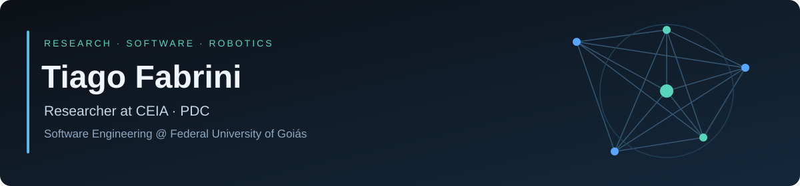
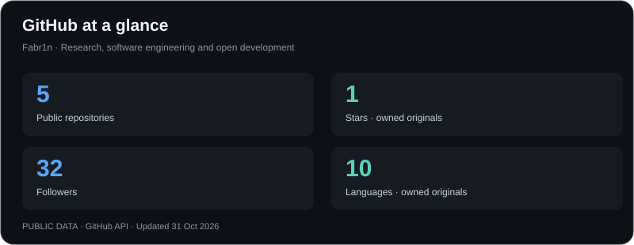
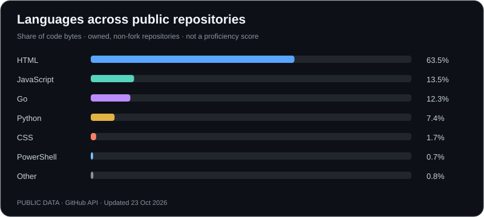
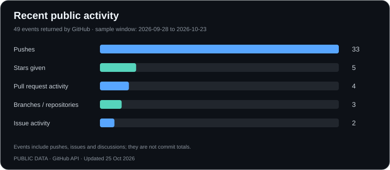

  

  <a href="https://www.linkedin.com/in/tiagofabrini/">LinkedIn</a> &nbsp;·&nbsp;
  <a href="https://orcid.org/0009-0004-0717-1774">ORCID</a> &nbsp;·&nbsp;
  <a href="https://lattes.cnpq.br/3152728960471144">Lattes</a> &nbsp;·&nbsp;
  <a href="mailto:fabrini@discente.ufg.br">Academic email</a>

## About

I'm **Tiago Henrique Silva Fabrini**, a **researcher at the Center of Excellence in Artificial Intelligence (CEIA)**, participating in the **Programa de Desenvolvimento de Competências (PDC)**, and a **Software Engineering undergraduate at the Federal University of Goiás (UFG)**.

My interests span **artificial intelligence, algorithms, scientific computing and robotics**. My experience includes hands-on work with **Unitree G1 humanoid and Go2 quadruped robots** in the CEIA / AKCIT research environment.

With a technical background in Chemistry from the Federal Institute of Goiás (IFG), I bring an interdisciplinary perspective to my studies and software projects.

## Current focus

| Area | Context |
| :--- | :--- |
| **Research** | Researcher at CEIA, participating in the PDC |
| **Robotics** | Hands-on experience with Unitree G1 and Go2 platforms |
| **Software engineering** | Undergraduate studies at UFG; software development and algorithms |
| **Research interests** | Artificial intelligence, scientific computing and complex systems |

## Technical toolkit

| Category | Technologies |
| :--- | :--- |
| **Languages** | Python · Go · JavaScript |
| **Backend** | Node.js · Express |
| **Web** | HTML5 · CSS3 |
| **Data & version control** | MySQL · Git · GitHub |

## Public projects

A selection of development work and learning repositories.

| Project | Overview | Technologies |
| :--- | :--- | :--- |
| **[Python studies](https://github.com/Fabr1n/ProjetoPython)** | Object-oriented exercises and a Snake game with Turtle | Python |
| **[UFG coursework](https://github.com/Fabr1n/ip-2026-01)** | Programming exercises and an HTTP server project | Go · PostgreSQL |
| **[MEG platform](https://github.com/Fabr1n/HACKATHON)** | Platform connecting women entrepreneurs in Goiás with mentors, courses and opportunities | JavaScript · Node.js · Express · HTML · CSS |

<strong>Earlier achievement · GO! Uai Tech 3 Hackathon</strong>

Contributed to the development of **MEG — Mulheres Empreendedoras Goianas**, with work spanning the web interface, backend and mentor-matching logic. Our team earned **4th place** at the GO! Uai Tech 3 Hackathon.

[Explore the project →](https://github.com/Fabr1n/HACKATHON)

## GitHub metrics

  
  
  

Updated daily from the GitHub API. Language shares represent code volume, not proficiency. Activity is a sample of up to 300 public events, not a complete contribution or commit history. Visual inspiration: [lowlighter/metrics](https://github.com/lowlighter/metrics).

## Education & languages

- **Software Engineering, B.Sc. — in progress** · Federal University of Goiás (UFG)
- **Technical qualification in Chemistry** · Federal Institute of Goiás (IFG)
- **Portuguese:** native · **English:** advanced (C1)

---

  <strong>Let's connect around research, robotics and software.</strong> 
  <a href="https://www.linkedin.com/in/tiagofabrini/">LinkedIn</a> · <a href="mailto:fabrini@discente.ufg.br">fabrini@discente.ufg.br</a>

