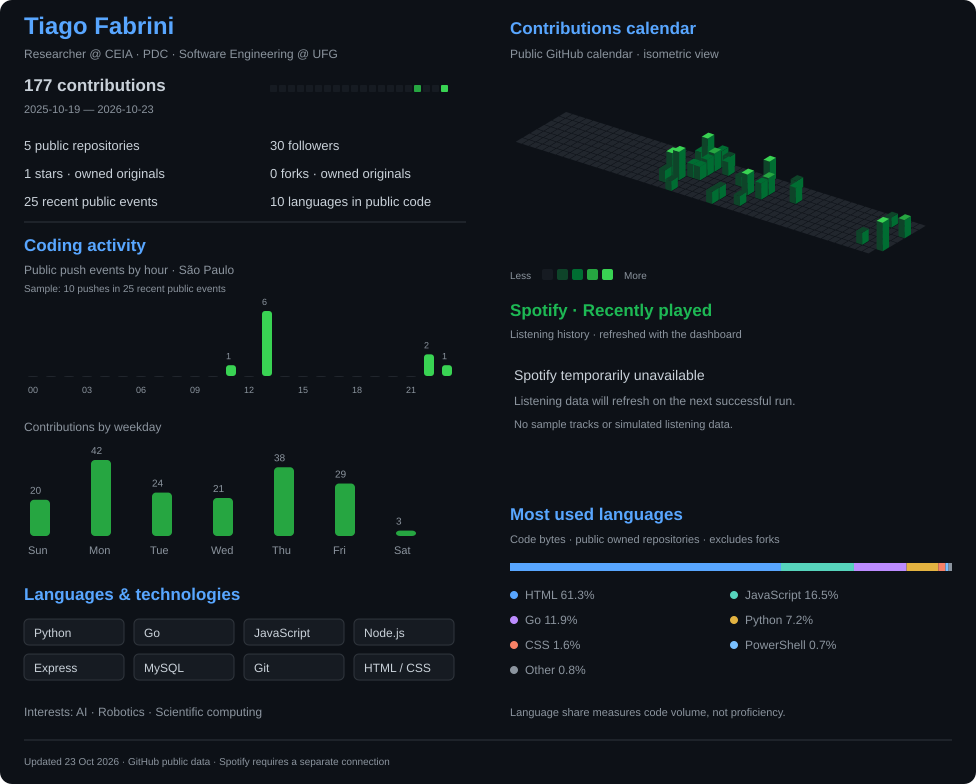

# Tiago H. S. Fabrini

**Researcher at CEIA · Software Engineering undergraduate at UFG**

I participate in CEIA's **Programa de Desenvolvimento de Competências (PDC)**. My interests span **artificial intelligence, algorithms, robotics and scientific computing**.

  &nbsp;
  

  &nbsp;
  &nbsp;
  &nbsp;
  

  

Public activity and code-language distribution · Updated every six hours · [Sources and methodology](#dashboard-methodology)

## Selected work

| Project | What it demonstrates | Stack |
| :--- | :--- | :--- |
| [Academic HTTP server](https://github.com/Fabr1n/ip-2026-01/tree/main/servidorHTTP-main) | Patient CRUD, HTTP handlers and database persistence | Go · PostgreSQL · HTML/CSS |
| [Python studies](https://github.com/Fabr1n/ProjetoPython) | Object-oriented exercises and a Snake game with keyboard input and collision handling | Python · Turtle |
| [MEG platform](https://github.com/Fabr1n/HACKATHON) | Earlier full-stack hackathon prototype connecting women entrepreneurs and mentors | Node.js · Express · JavaScript |

<strong>Research & academic background</strong>

I'm **Tiago Henrique Silva Fabrini**, a researcher at the **Center of Excellence in Artificial Intelligence (CEIA)**, participating in the **Programa de Desenvolvimento de Competências (PDC)**, and a Software Engineering undergraduate at the **Federal University of Goiás (UFG)**.

My experience includes hands-on work with **Unitree G1 humanoid and Go2 quadruped robots** in the CEIA / AKCIT research environment. I'm interested in artificial intelligence, algorithms, scientific computing and complex systems.

**Education:** B.Sc. in Software Engineering at UFG — in progress, since 2026. Technical qualification in Chemistry at IFG.

**Languages:** Portuguese (native) · English (advanced).

<strong>Earlier achievement · GO! Uai Tech 3 Hackathon</strong>

Contributed to **MEG — Mulheres Empreendedoras Goianas**, with work spanning the web interface, backend and mentor-matching logic. Our team earned **4th place** at GO! Uai Tech 3.

[Explore MEG →](https://github.com/Fabr1n/HACKATHON)

<strong>Dashboard methodology & optional Spotify integration</strong>

- **Contributions:** the public GitHub contribution calendar, with the date range shown in the panel. Private contributions may differ from the total visible while signed in.
- **Hourly activity:** a sample of up to 300 recent public events, grouped by push-event time in America/Sao_Paulo. These bars count push events, not individual commits.
- **Weekday activity:** contribution counts from the public calendar.
- **Language shares:** code bytes in owned public repositories, excluding forks. They describe repository composition, not proficiency.
- **Technology badges:** tools used in studies and projects; they are not skill ratings.
- **Refresh:** scheduled every six hours, subject to GitHub Actions availability.

The layout is inspired by [lowlighter/metrics](https://github.com/lowlighter/metrics); this dashboard uses its own generator.

Spotify recent listening is optional. Tracks appear when the connection succeeds; otherwise, the panel presents research interests and robotics experience.

[Workflow](./.github/workflows/metrics.yml) · [Spotify setup](./docs/spotify-setup.md) · [Public calendar data](./assets/metrics/calendar.json)

